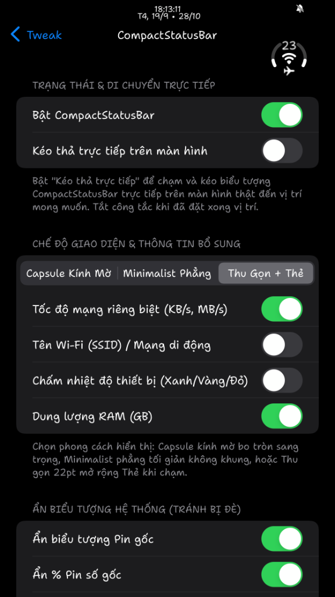
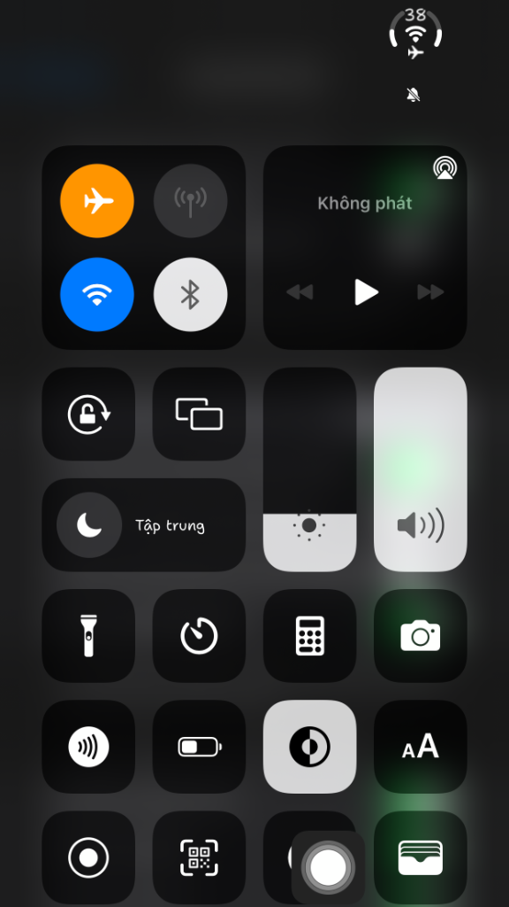

# CompactStatusBar ⚡

[](https://github.com/Hoangnguyennaaa/CompactStatusBar/releases)
[](https://github.com/Hoangnguyennaaa/CompactStatusBar/actions/workflows/build_deb.yml)
[](https://github.com/Hoangnguyennaaa/CompactStatusBar)
[](https://github.com/Hoangnguyennaaa/CompactStatusBar)
[](LICENSE)

**CompactStatusBar** là tweak tinh chỉnh thanh trạng thái (Status Bar) tối giản, hiện đại và chuẩn mực dành cho các thiết bị iPhone/iPad đã Jailbreak. Tweak tích hợp **Pin (Battery)**, **Sóng di động (Cellular)** và **Wi-Fi / Mạng (Network)** vào một biểu tượng tròn 3-trong-1 (Circular 3-in-1 Gauge) đồng nhất, loại bỏ hoàn toàn các biểu tượng cồng kềnh mặc định của iOS.

Được phát triển dựa trên ngôn ngữ thiết kế DuoBar kết hợp chuẩn Apple Human Interface Guidelines, CompactStatusBar mang lại trải nghiệm thị giác sắc nét, mượt mà và hoạt động đồng bộ trên toàn bộ hệ thống.

---

## 📸 Hình ảnh Demo (Screenshots)

> *Dán ảnh chụp màn hình thực tế của bạn vào thư mục dự án và chèn đường dẫn vào các vị trí dưới đây:*

<p align="center">
  <!-- THAY THẾ LINK HOẶC FILE ẢNH VÀO ĐÂY -->
  
  &nbsp;&nbsp;&nbsp;&nbsp;
  
</p>

<p align="center">
  <em>Hình 1: Hiển thị Đỉnh vòm (Top Crown) trên Màn hình chính | Hình 2: Đồng bộ Control Center & Thẻ thông số HUD</em>
</p>

---

## 📦 Tải về (Releases)

Bạn có thể tải về file cài đặt mới nhất được biên dịch tự động sẵn sàng sử dụng:

* **Tải bản mới nhất:** 👉 [**Tải CompactStatusBar (.deb) tại GitHub Releases**](https://github.com/Hoangnguyennaaa/CompactStatusBar/releases)
* **Phiên bản hiện tại:** `v1.4.8 (Rootless arm64)`
* **Quản lý cài đặt khuyến nghị:** Sileo, Zebra hoặc Filza.

---

## 🌟 Điểm nổi bật (Features)

```
       [ 100 ]            <- Đỉnh vương miện (Top Crown) hiển thị % Pin
    ╭───────────╮         
   │     ╭─╮     │        <- Vòng cung Pin (Màu xanh Apple System Green #34C759)
   │    ( • )    │        <- Tâm Gauge: Quạt Wi-Fi 2 tầng / Logo 5G/4G / Sét sạc
   │     ╰─╯     │        
    ╰──●─●─●─●──╯         <- 4 chấm sóng di động uốn cong đáy vòng tròn
```

### 1. Vòng đo Pin chuẩn hình học (Seamless Geometric Arc)
* **Khớp nối hình học 100%:** Cung đo bắt đầu từ góc 140° kéo dài 260° qua đỉnh đến 400° (40°). Khe hở 100° dưới đáy tiếp giáp hoàn hảo với các chấm sóng di động, loại bỏ hoàn toàn hiện tượng đứt gãy hoặc lệch bán kính.
* **Màu sắc động Apple (Dynamic Battery Colors):**
  * 🔋 **Bình thường (> 20%):** Màu xanh Apple System Green (`#34C759`).
  * ⚡ **Đang sạc:** Sáng xanh rực rỡ kèm hiệu ứng nhịp thở phát sáng (Breathing Glow).
  * 🟡 **Chế độ nguồn điện thấp (LPM):** Màu vàng đặc trưng Apple (`#FFCC00`).
  * 🔴 **Pin yếu (≤ 20%):** Tự động chuyển màu đỏ cảnh báo (`#FF3B30`).
* **Đa chế độ hiển thị phần trăm pin:**
  * **Đỉnh vòm (Top Crown - Mặc định):** Số % lồng khéo léo vào khe đỉnh 12 giờ của vòng tròn, giữ nguyên tỷ lệ 1:1 siêu gọn.
  * **Ở tâm (Center):** Số % nằm ngay chính giữa gauge.
  * **Kế bên (Beside):** Hiển thị dạng viên thuốc Capsule kèm tốc độ mạng và tên Wi-Fi.
  * **Mép trái (Left Side):** Số % nằm gọn gàng bên trái gauge.
  * **Ẩn (Minimalist):** Chỉ hiển thị vòng đo và chấm sóng, ẩn số %.

### 2. Chấm sóng di động uốn cong đáy (Cradled Cellular Dots)
* **Bán kính đồng tâm tuyệt đối:** 4 chấm tròn (hoặc 5 chấm tùy chọn) phân bố đều đặn với bước nhảy góc 20° trên đúng bán kính 9.0pt của gauge.
* **Tự động nhận diện mức sóng:** Số chấm sáng tương ứng với độ mạnh yếu của sóng mạng (0 đến 4 vạch).
* **Độ tương phản cao:** Các chấm chưa sáng (unlit) luôn giữ độ mờ 25-28% rõ nét trên cả hình nền sáng lẫn hình nền tối, không bao giờ bị biến mất.

### 3. Tâm Gauge đa năng (Dynamic Center Slot)
* **Wi-Fi đa mức:** Khi kết nối Wi-Fi, hiển thị quạt Wi-Fi vector gồm điểm phát sóng và 2 tầng sóng uốn lượn.
* **Mạng di động (5G / 4G / LTE):** Khi tắt Wi-Fi hoặc dùng dữ liệu di động, tâm gauge tự động hiển thị thế hệ mạng (`5G`, `4G`, `LTE`, `3G`) với phông chữ đậm sắc sảo, không để lại hốc rỗng.
* **Chế độ máy bay & Không có SIM:** Hiển thị silhouette máy bay hoặc thẻ SIM gạch chéo tinh gọn.
* **Tia sét sạc (Charging Bolt):** Hiển thị biểu tượng tia sét ngay tại tâm khi cắm sạc.

### 4. Đồng bộ hóa Control Center & Chống rung giật
* **Đồng bộ Control Center (`ccSyncWithStatusBar`):** Tự động căn chỉnh vị trí icon pin trong Trung tâm điều khiển khớp chuẩn theo thanh trạng thái chính, giải quyết triệt để lỗi nhảy lệch hoặc khó căn chỉnh.
* **Bộ lọc chống giật (Jitter Filter):** Cố định tọa độ neo vững chắc, không bị rung lắc khi mở ứng dụng hay vuốt chuyển trang.

### 5. Cử chỉ tương tác thông minh (Smart Gestures)
* **Chạm 1 lần (Single Tap):** Chuyển đổi tức thì giữa hiển thị % Pin và % RAM hệ thống.
* **Chạm 2 lần (Double Tap):** Mở thẻ thông số HUD chi tiết (Dung lượng pin, IP, SSID, RAM thực tế, CPU, Tốc độ mạng).
* **Nhấn giữ 0.5s (Long Press):** Bật/tắt chế độ **Kéo thả tự do (Drag & Drop Mode)** để di chuyển vị trí gauge trực tiếp trên màn hình với phản hồi rung Haptic.

---

## 📱 Thiết bị & Môi trường đã thử nghiệm (Tested Devices)

Tweak đã được biên dịch và kiểm thử thực tế trên các dòng máy và công cụ Jailbreak sau:

| Thiết bị (Device) | Phiên bản iOS | Công cụ Jailbreak | Trạng thái (Status) |
| :--- | :--- | :--- | :--- |
| **iPhone 7 Plus** | iOS 15.8.2 | Palera1n (Rootless) |  Hoạt động hoàn hảo |
| **iPhone X** | iOS 16.7.x | Palera1n (Rootless) |  Hoạt động hoàn hảo |
| **iPhone 11 / 12 / 13** | iOS 15.0 – 16.5 | Dopamine 2.x (Rootless) |  Hoạt động hoàn hảo |
| **iPhone 14 Series** | iOS 16.0 – 16.6.1 | Bootstrap + Serotonin |  Hoạt động ổn định |

*Tương thích tốt với màn hình Notch (Tai thỏ), Dynamic Island và thiết bị cổ điển (Classic 16:9).*

---

## 🚀 Hướng dẫn Cài đặt (Installation)

1. Tải file `CompactStatusBar_rootless.deb` từ mục [Releases](https://github.com/Hoangnguyennaaa/CompactStatusBar/releases).
2. Mở file bằng trình quản lý gói của bạn:
   * **Sileo:** Nhấn vào file -> Chọn *Mở trong Sileo* -> Chọn **Get** -> **Confirm**.
   * **Zebra / Filza:** Cài đặt trực tiếp gói DEB.
   * Hoặc qua Terminal:
     ```bash
     dpkg -i CompactStatusBar_rootless.deb
     ```
3. Khởi động lại SpringBoard (**Respring**) để kích hoạt tweak.
4. Mở **Cài đặt (Settings)** -> kéo xuống chọn mục **CompactStatusBar** để kích hoạt và tùy chỉnh các chế độ hiển thị.

---

## ⚠️ Cảnh báo & Miễn trừ trách nhiệm (Disclaimer)

* Tweak này là phần mềm mã nguồn mở được phát triển phi lợi nhuận nhằm mục đích cá nhân hóa giao diện iOS.
* Việc Jailbreak và can thiệp vào tệp hệ thống luôn đi kèm rủi ro tiềm ẩn. Tác giả **KHÔNG CHỊU TRÁCH NHIỆM** đối với bất kỳ sự cố nào xảy ra với thiết bị của bạn, bao gồm nhưng không giới hạn ở: treo máy (bootloop), xung đột với các tweak bên thứ ba khác, mất mát dữ liệu hoặc các lỗi phần mềm phát sinh trong quá trình sử dụng.
* Hãy luôn sao lưu dữ liệu cá nhân (Backup) trước khi cài đặt bất kỳ tweak mới nào.

---

## ☕ Ủng hộ tác giả (Support & Donate)

Nếu bạn yêu thích **CompactStatusBar** và muốn ủng hộ tác giả một ly cà phê để tiếp tục duy trì và nâng cấp dự án, bạn có thể quét mã QR bên dưới:

<p align="center">
  <!-- THAY THẾ ĐƯỜNG DẪN ẢNH QR CODE CỦA BẠN VÀO ĐÂY -->
  
</p>

<p align="center">
  <strong>Cảm ơn bạn rất nhiều vì đã ủng hộ dự án! ❤️</strong><br>
  <em>(Momo / Chuyển khoản ngân hàng / Quét mã QR)</em>
</p>

---

## 🛠 Hướng dẫn Tự Build từ mã nguồn (Build from Source)

Yêu cầu máy tính macOS cài đặt Xcode Developer Tools:
```bash
# Clone repository
git clone https://github.com/Hoangnguyennaaa/CompactStatusBar.git
cd CompactStatusBar/Tweak

# Cấp quyền thực thi và chạy script đóng gói
chmod +x build_deb.sh
./build_deb.sh
```
File `CompactStatusBar_rootless.deb` sẵn sàng cài đặt sẽ được tạo trực tiếp tại thư mục dự án.

---

## 📄 Bản quyền (License)

Dự án được phân phối theo giấy phép mã nguồn mở **MIT License**. Bạn có thể tự do chỉnh sửa, phát triển thêm và chia sẻ.

* **Tác giả:** Hoangnguyen ([@Hoangnguyennaaa](https://github.com/Hoangnguyennaaa))
* **Ý tưởng thiết kế:** DuoBar / Android Duo StatusBar Concept.
